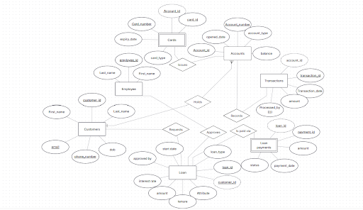

# Bank Management System (BankDB)

[](https://www.mysql.com/)
[](https://nodejs.org/)
[](https://react.dev/)
[](LICENSE)

An enterprise-grade, full-stack **Core Banking Management System** engineered to model and demonstrate the complete spectrum of **Relational Database Management Systems (RDBMS)** concepts. Built with React (Vite), Express.js, and MySQL 8.0 (InnoDB engine).

Developed as part of **CSC2131 — Relational Database Management Systems Lab**, Department of Computer Science & Engineering, Manipal University Jaipur.

---

## 🏛️ Project Overview

BankDB models the transactional core of retail and commercial banking with formal database normalization (1NF $\rightarrow$ 3NF), atomic transaction processing, referential integrity cascades, and automated trigger audits.

### Key Highlights
- **10 Relational Tables:** `Customers`, `Employee`, `Accounts`, `Cards` (Weak Entity), `Transactions`, `Loan`, `Loan_payments` (Weak Entity), `Account_Tiers`, `employee_audit`, and `Customer_Archive`.
- **ACID Transaction Engine:** Interactive fund transfers with explicit row-level locking (`SELECT ... FOR UPDATE`), transaction `SAVEPOINT`s, and automated rollback handlers.
- **Weak Entity Modeling:** Composite Primary Keys on dependent sets (`Cards`: `(card_id, Account_id)`, `Loan_payments`: `(payment_id, loan_id)`) with `ON DELETE CASCADE`.
- **Database Programmability:**
  - **Deterministic Stored Functions:** `fn_calculate_emi` (monthly reducing balance compound amortization).
  - **Stored Procedures:** `sp_process_atomic_transfer`, `sp_pay_loan_installment`, and cursor-based batch interest calculation (`sp_batch_credit_savings_interest`).
  - **Audit Triggers:** `BEFORE INSERT` validation triggers and `AFTER INSERT/UPDATE/DELETE` employee auditing trails.
  - **Views:** Multi-table analytical view (`High_Value_Customers`), dynamic computed view (`Loan_Amortization_Schedule_View`), and updatable single-table view (`Account_Summary`).

---

## 📐 Entity-Relationship (ER) Architecture



---

## 🛠️ Tech Stack

- **Frontend:** React 18, Vite, TailwindCSS / Custom CSS, Lucide Icons
- **Backend:** Node.js, Express.js, `mysql2/promise` connection pooling
- **Database:** MySQL 8.0+ (InnoDB Storage Engine)
- **Reporting:** Formal academic report generated with custom typography and clean A4 print styles.

---

## 🚀 Getting Started

### 1. Prerequisites
- [Node.js](https://nodejs.org/) (v18+)
- [MySQL Server](https://dev.mysql.com/downloads/mysql/) (v8.0+)

### 2. Database Setup
1. Open MySQL Workbench or your terminal:
   ```bash
   mysql -u root -p
   ```
2. Execute the master schema and seed script:
   ```sql
   SOURCE BankDB_Master.sql;
   ```
   *(Or copy-paste the contents of `BankDB_Master.sql` into MySQL Workbench and run.)*

### 3. Server Configuration
1. Navigate to the `server/` directory:
   ```bash
   cd server
   cp .env.example .env
   ```
2. Edit `.env` with your MySQL credentials:
   ```env
   DB_HOST=localhost
   DB_PORT=3306
   DB_USER=root
   DB_PASSWORD=your_mysql_password
   DB_NAME=BankDB
   JWT_SECRET=bankdb_secret_key_2026
   PORT=5000
   ```
3. Install dependencies:
   ```bash
   npm install
   ```

### 4. Client Setup
1. In another terminal, navigate to the `client/` directory:
   ```bash
   cd client
   npm install
   ```

### 5. Running the Application
From the root workspace directory, run both frontend and backend concurrently:
```bash
npm run dev
```
- **Web App:** `http://localhost:5173`
- **Backend API:** `http://localhost:5000`

---

## 📂 Repository Structure

```
├── BankDB_Master.sql                           # Master MySQL DDL, DML, Triggers, Procedures & Views
├── Bank_Management_System_Project_Report.md    # 9-Chapter Formal Academic Report
├── Bank_Management_System_Project_Report.pdf   # 22-page Print-Ready PDF
├── Bank_Management_System_Project_Report.html  # Rendered HTML report
├── erd.png                                     # Verified ER Diagram
├── generate_pdf.js                             # Headless PDF generation script
├── client/                                     # React + Vite Frontend
│   ├── src/
│   │   ├── components/                         # Layout & SQL Lab Telemetry Inspector
│   │   ├── pages/                              # Customer Portal, Acid Center, Admin, Cards, Loans
│   │   └── services/api.js                     # REST API client
├── server/                                     # Node.js + Express Backend
│   ├── db/pool.js                              # MySQL connection pool
│   ├── routes/                                 # Modular Express routes
│   └── .env.example                            # Safe environment template
└── package.json                                # Workspace root scripts
```

---

## 📜 Documentation

The complete academic project report covering Relational Algebra ($\sigma, \pi, \bowtie, \gamma$), 3NF Normalization proofs, 20 representative queries, and oral viva questions is available in:
- Markdown: [`Bank_Management_System_Project_Report.md`](Bank_Management_System_Project_Report.md)
- PDF: [`Bank_Management_System_Project_Report.pdf`](Bank_Management_System_Project_Report.pdf)

---

## 👤 Author

- **Shaurya Upadhyay**
- Registration Number: **2502052080** | Section: **N4**
- Supervisor: **Dr. Nandini Babbar**
- Department of Computer Science & Engineering, **Manipal University Jaipur** (2025–2029)

---

## 📄 License

This project is licensed under the [Apache License 2.0](LICENSE).